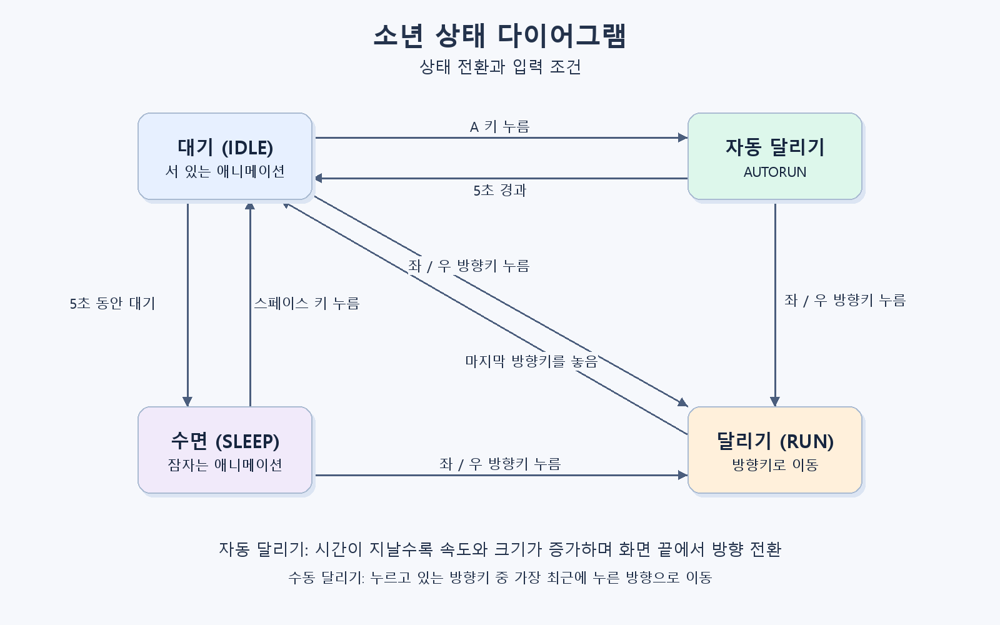

# Drill 11: 소년 자동 달리기

Pico2D로 만든 2D 애니메이션 예제입니다. 소년을 좌우로 움직이거나 자동 달리기를 시작할 수 있습니다.

## 실행 방법

Python과 `pico2d`, `transitions` 패키지가 필요합니다. 필요한 패키지를 설치한 뒤 프로젝트 폴더에서 실행합니다.

```bash
python -m pip install pico2d transitions
python main.py
```

이미지를 상대 경로로 불러오므로 반드시 이 저장소의 폴더에서 실행해야 합니다.

## 조작 방법

| 입력 | 동작 |
| --- | --- |
| 왼쪽 / 오른쪽 방향키 | 해당 방향으로 달리기 |
| A 키 | 대기 상태에서 자동 달리기 시작 |
| 자동 달리기 중 방향키 | 자동 달리기를 취소하고 해당 방향으로 달리기 |
| 스페이스 키 | 잠든 상태에서 깨우기 |
| Esc 또는 창 닫기 | 게임 종료 |

## 동작 설명

- 자동 달리기 중에는 조작 없이 이동하고, 속도와 소년의 크기가 점점 증가합니다.
- 화면의 좌우 끝에 닿으면 자동으로 방향을 바꿉니다.
- 자동 달리기 시작 후 5초가 지나면 기본 크기의 대기 상태로 돌아갑니다.
- 대기 상태에서 5초 동안 입력이 없으면 마지막으로 바라본 방향으로 누워 잠듭니다.
- 방향키를 누르거나 스페이스 키를 눌러 잠에서 깨어날 수 있습니다.

## 프로젝트 구성

| 파일 | 설명 |
| --- | --- |
| `main.py` | 게임 실행 및 입력·화면 갱신 루프 |
| `boy.py` | 소년의 상태, 이동, 애니메이션 및 자동 달리기 |
| `grass.py` | 배경 잔디 표시 |
| `stateDiagram.png` | 소년의 상태와 전환 조건을 정리한 다이어그램 |
| `developmentDrill11.md` | 개발 요구사항, 설계 및 검증 방법 |
| `boys_team_10000.py` | 소년 10,000명을 표시하는 별도 예제 |

## 상태 다이어그램


